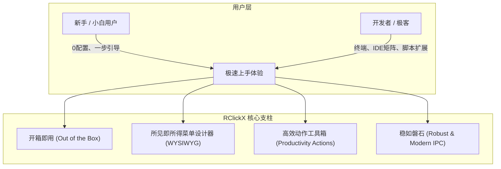

# RClickX 全面改造与重发布规划路线图 (Roadmap & Implementation Plan)

> **项目代号**：RClickX (Next-Gen Right Click Enhancer for macOS)
> **基线版本**：基于 RClick (wflixu) 派生重构
> **开源协议**：GNU General Public License v3.0 (GPLv3)
> **核心使命**：**开箱即用（Zero-Config）、颜值即正义、极速响应、深度赋能开发者与办公用户**

---

## 目录
- [一、背景与核心痛点诊断](#一背景与核心痛点诊断)
- [二、开源协议合规与品牌重塑](#二开源协议合规与品牌重塑)
- [三、核心产品定位与革新目标](#三核心产品定位与革新目标)
- [四、功能规划与架构重构](#四功能规划与架构重构)
- [五、分阶段实施路线图 (Milestones)](#五分阶段实施路线图-milestones)
- [六、近期任务排期清单 (TODO Checklist)](#六近期任务排期清单-todo-checklist)

---

## 一、背景与核心痛点诊断

原版 RClick 虽然具备双进程（主程序 + FinderSync 扩展）的基础框架，但在实际使用中存在严重的交互门槛和逻辑缺陷，导致用户体验非常差：

### 1. 致命缺陷：首次安装“右键不显示 / 必须手动点恢复默认初始化”
* **代码根因**：
  * 在 `AppState.init` 中，数据加载 `refresh()` 是在应用启动时同步/微任务并发触发的；
  * 而在 `RClickApp.swift` 中，种子数据初始化 `SharedDataManager.initializeDefaultData` 是在后台异步任务中运行的；
  * **时序颠倒**：内存中读取配置发生在默认数据写入数据库之前，导致首次安装启动时，`AppState` 的动作、应用、新建文件列表全为空数组 `[]`，且数据库写入完成后**未触发任何通知重载内存与同步扩展**；
  * 用户装上后右键菜单完全空白，必须在设置界面的各个 Tab 里翻到最下面点击“恢复默认”（Restore Defaults）才能让数据出现在菜单中。这对于普通小白用户是致命的体验硬伤。
* **改进目标**：
  * **零配置（Zero-Config）启动流**：启动入口构建严格的初始化流水线（Boot Pipeline），若数据库为空，必须**同步/阻塞式完成种子数据初始化**，随后立即装载并向 FinderSync 广播最新菜单，实现真正意义上的**“装上即用”**。

### 2. 反人类体验：菜单自定义依赖手改 `custom_menu.json`
* **痛点**：
  * 原版在 v2.2.1 引入自定义菜单时，要求用户在 Finder 中打开 `custom_menu.json` 手动编辑 JSON 代码，甚至官方在设置页提示“把这个文件发给 ChatGPT/Claude 来排版”；
  * 普通用户极易因 JSON 语法错误（如缺少逗号、引号）导致整个菜单解析失败回退；
* **改进目标**：
  * **彻底干掉手动编辑 JSON**；
  * 开发基于 SwiftUI 的**所见即所得（WYSIWYG）可视化拖拽菜单排版器**：支持树状层级拖拽、自由创建二级子菜单、实时预览右键菜单形态。

### 3. 缺乏新手引导：访达扩展与权限获取打断心流
* **痛点**：
  * macOS 对访达扩展有极严格的限制，必须在「系统设置 → 登录项与扩展 → 访达扩展」中手动勾选，但原版没有引导窗口，用户经常以为软件坏了；
  * 采用 Security-Scoped Bookmarks 后，在未授权目录下右键操作文件会频繁弹出 `NSOpenPanel` 强迫用户选目录授权，严重打断右键提效的节奏；
* **改进目标**：
  * **3 步现代化新手引导向导（Onboarding Wizard）**：首次启动弹出优雅的向导弹窗，一键跳转访达扩展设置，并提供一键授权“常用工作区（桌面/下载/文档）”的选项。

### 4. 动作功能极度单薄
* **痛点**：
  * 内置动作仅有 5 个（复制路径、直接删除、隐藏、显示、隔空投送），甚至连“在终端打开当前目录”、“使用 VS Code / Cursor 打开”都要用户在外部应用里手配；
  * 缺少开发者和重度办公用户高频需要的功能（哈希计算、软链接创建、复制文件名/相对路径/UNIX转义路径、快速新建编程语言模板等）。

---

## 二、开源协议合规与品牌重塑

本项目基于原作者李旭（GitHub: `wflixu/RClick`）的代码派生，采用 **GPLv3 许可协议**。为了完全合法合规并树立独立的新产品形象，必须遵守以下原则：

| 维度 | 合规要求 / 改造动作 |
| :--- | :--- |
| **开源义务** | RClickX 发布后必须**全量开源（GPLv3）**，保证派生代码完全透明公开。 |
| **原作者致谢** | 在仓库根目录保留原作者的 `LICENSE`，在应用 `About（关于）` 界面与 `README.md` 中显著注明：*“Based on RClick by wflixu, licensed under GPL-3.0”*。 |
| **品牌独立** | 1. 软件更名为 **RClickX**（或后续选定品牌名）；<br>2. 重新设计全新的现代矢量 App 图标、状态栏图标与宣传图；<br>3. 更换唯一 Bundle Identifier（例如 `com.yourdomain.rclickx`），杜绝与原版系统级冲突。 |
| **分发策略** | **不采用 Mac App Store**（避免 App Store 条款与 GPLv3 发生法律冲突）；<br>全线采用 **GitHub Releases + DMG 镜像 + Homebrew Cask** 分发，并配置自动化打包公证流程。 |

---

## 三、核心产品定位与革新目标



* **目标 1：开箱即用（Zero-Config）**
  下载安装打开后，默认预置高频常用动作与模板，无需任何多余配置即可在右键中体验完整功能。
* **目标 2：新手向导（Smooth Onboarding）**
  启动即检测访达扩展启用状态，动画引导 10 秒内完成系统授权。
* **目标 3：所见即所得（Visual Customizer）**
  在设置面板中通过拖拽即可调整菜单顺序、新建子菜单、切换图标、重命名，告别 JSON 文件。
* **目标 4：极客与效率工具库（Power Tools）**
  内置终端、现代代码编辑器、哈希校验、软链接替身、自定义脚本等高频动作。

---

## 四、功能规划与架构重构

### 1. 启动生命周期重构 (Boot Pipeline)
```
应用启动 (RClickXApp)
  ├── 1. 打开共享 SwiftData 容器
  ├── 2. 检查数据版本与种子状态
  │     └── 若为空：同步注入默认动作、默认文件类型、默认常用目录并 Save
  ├── 3. AppState 加载已初始化的完整数据并建立内存模型
  ├── 4. 首次启动检测：
  │     ├── 若未开启访达扩展：弹出现代化 Onboarding 向导
  │     └── 预授权引导（推荐授权当前用户目录 ~）
  └── 5. 立即广播 IPC 菜单配置至 FinderSync，菜单瞬时生效
```

### 2. 核心功能矩阵扩展

#### A. 终端与开发工具矩阵（开发者刚需）
* **终端直达**：自动扫描系统已安装终端，右键空白处或文件夹一键呼出：
  * 系统原生 Terminal、iTerm2、Warp、Ghostty、Alacritty、Kitty
* **编辑器直达**：
  * VS Code、Cursor、Sublime Text、Zed、Xcode、IntelliJ IDEA
* **路径与命令行工具**：
  * 复制 POSIX 绝对路径
  * 复制转义路径（自动为含空格路径添加 `\`，方便直接在终端粘贴）
  * 仅复制文件名 / 仅复制文件所在父目录路径
  * 复制文件 URL (`file://...`)

#### B. 文件操作与系统工具
* **快速新建文件 (New File Templates)**：
  * 默认开启：Markdown (`.md`)、文本文档 (`.txt`)、JSON (`.json`)、Shell 脚本 (`.sh`)、Python 脚本 (`.py`)
  * 办公格式：Word (`.docx`)、Excel (`.xlsx`)、PPT (`.pptx`)、Keynote、Pages、Numbers
  * **自定义模板文件夹**：用户可直接向设置界面拖入任意自定义文件模板，自动生成右键项。
* **进阶文件管理**：
  * 创建软链接 (Symbolic Link) 与替身 (Alias)
  * 快速计算校验和：MD5 / SHA256 / SHA1（支持一键复制对比）
  * 隐藏 / 取消隐藏文件（带直观图标状态）
  * 彻底删除（绕过废纸篓）

#### C. 可视化菜单排版器（替代 custom_menu.json）
* 提供双栏或树形视图：
  * **左侧**：可用动作与应用池（拖拽源）
  * **右侧**：当前右键菜单树（包含顶层项、一级子菜单、二级子菜单）
* 支持直接添加“分组分隔线”（Separator）与“新建子菜单分组”
* 支持为每个项目自定义显示名称、切换 SF Symbol 图标
* 支持在右侧实时预览右键菜单的弹出效果

---

## 五、分阶段实施路线图 (Milestones)

### 阶段一：急诊修复与开箱即用（Sprint 1）
* [x] **修复数据初始化时序问题**：重构 `SharedDataManager` 与 `AppState`，保证初次启动同步灌装默认数据。
* [x] **开箱即用默认配置调优**：
  * 默认启用核心高频动作（复制路径、直接删除、新建常见文件、AirDrop 等）。
  * 默认自动探测系统中已安装的终端（Terminal、iTerm2、Warp、Ghostty）与编辑器（VS Code、Cursor、Zed）并加入右键。
* [x] **开发首次启动新手引导（Onboarding Window）**：
  * 引导 1：检测并一键打开「访达扩展」设置面板，支持实时状态感知；
  * 引导 2：一键引导授权常用目录（解决反复弹窗问题）；
  * 引导 3：成功完成动画与状态保存，并在菜单栏常驻“新手引导…”入口随时可唤回。

### 阶段二：品牌换新与工程解耦（Sprint 2）
* [x] **项目全面更名为 RClickX**：
  * 应用显示名、菜单栏、设置窗口与新手向导统一更名为 `RClickX`。
  * 更换唯一 Bundle Identifier (`com.cutechen.rclickx`, `com.cutechen.rclickx.FinderSyncExt`, `com.cutechen.rclickxTests`)。
  * 更换 App Group Identifier 为 `group.com.cutechen.rclickx`，解耦原版共享容器冲突。
  * 更新检查更新仓库地址指向 `Cute-chen/RClickX`。
* [x] **开源致谢与规范**：
  * 在 `About` 设置页面醒目标注 GNU GPLv3 协议与原作者致谢（*Based on RClick by 李旭 (wflixu)*）。
  * 增加直达原仓库的致敬链接。
  * 在 `README.md` 中显著添加开源声明与原作者致谢。
* [x] **清理冗余旧代码与文案**：
  * 优化设置页面中关于 `custom_menu.json` 的说明文案。

### 阶段三：可视化菜单设计器（Sprint 3）
* [x] **设计可视化菜单数据模型**：将原本平铺的配置升级为具备树状层级关系的 `DesignerItem` / `MenuNode` 体系。
* [x] **实现 SwiftUI 可视化设计器排版界面**：
  * 支持上下平移排序、拖入/移入移出子菜单；
  * 支持增加/删除子菜单与分割线；
  * 自定义菜单标题与 SF Symbols 图标检索；
  * 支持查看与导出 Raw JSON，自动修复引用状态。
* [x] **实时访达菜单高仿真预览**：在设置面板侧边直观渲染当前菜单层级效果，支持深色/浅色模式切换与二级子菜单交互展开。

### 阶段四：实用动作库全面扩充（Sprint 4）
* [x] **开发/终端集成**：
  * 编写统一的现代终端集成，智能检测 Ghostty、Warp、iTerm2、macOS Terminal。
  * 编写现代代码编辑器集成，智能检测 Cursor、VS Code、Zed、Sublime Text。
* [x] **路径工具增强**：
  * 新增复制纯文件名（单选/批量）、复制完整路径。
* [x] **实用系统动作**：
  * 新增软链接创建动作（Unix 符号链接 + 访达自动高亮）；
  * 新增文件 Hash 计算（流式 CryptoKit SHA-256 / MD5 计算 + 一键复制剪贴板）。
* [x] **模板管理增强**：
  * 支持在新建文件设置页直接拖拽文件作为新建模板。

### 阶段五：CI/CD 自动化与发布上线（Sprint 5）
* [x] **构建与打包脚本**：
  * 编写 `scripts/build-dmg.sh`，支持 `create-dmg` 精美布局并平滑降级 `hdiutil`，自动生成 Release DMG、ZIP 与 SHA256 校验和。
* [x] **GitHub Actions 自动化**：
  * 升级 `.github/workflows/release.yml`，适配 `com.cutechen.rclickx` 与 `group.com.cutechen.rclickx`；
  * 支持官方证书签名/公证流水线与社区无证书 Ad-hoc 自动降级发布双模式。
* [x] **文档与宣传**：
  * 编写中英文现代化 README.md，包含完整功能特性图文、构建指令与开源致谢；
  * 制作 Homebrew Cask 配方 `Casks/rclickx.rb`。

---

## 六、近期任务排期清单 (TODO Checklist)

优先级排序（从最迫切到进阶）：

| 优先级 | 任务项 | 状态 | 涉及关键文件 |
| :---: | :--- | :---: | :--- |
| **P0** | **修复启动初始化逻辑，让首次安装默认拥有完备菜单** | ✅ 已完成 | `ModelContainer.swift`, `AppState.swift`, `RClickApp.swift` |
| **P0** | **默认内置动作与常用应用扫描（Terminal/VSCode/Cursor）** | ✅ 已完成 | `RCBase.swift`, `ActionEntity.swift`, `AppEntity.swift` |
| **P1** | **制作首启新手向导（Onboarding），引导开启访达扩展** | ✅ 已完成 | `OnboardingView.swift`, `RClickApp.swift` |
| **P1** | **工程改名与 Bundle ID 换新 (RClickX)** | ✅ 已完成 | `project.pbxproj`, `Info.plist`, `Constants.swift` |
| **P2** | **重构设置面板：制作所见即所得的可视化菜单编辑器** | ✅ 已完成 | `MenuDesignerTabView.swift`, `MenuPreviewView.swift` |
| **P2** | **加入“在终端打开 / Cursor 打开”与路径扩展工具** | ✅ 已完成 | `ActionService.swift`, `RCBase.swift` |
| **P3** | **配置 DMG 自动化构建与 GitHub Release CI** | ✅ 已完成 | `.github/workflows/release.yml`, `scripts/build-dmg.sh`, `Casks/rclickx.rb` |
