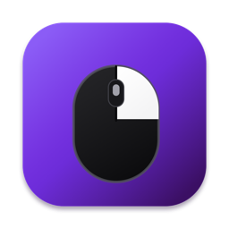
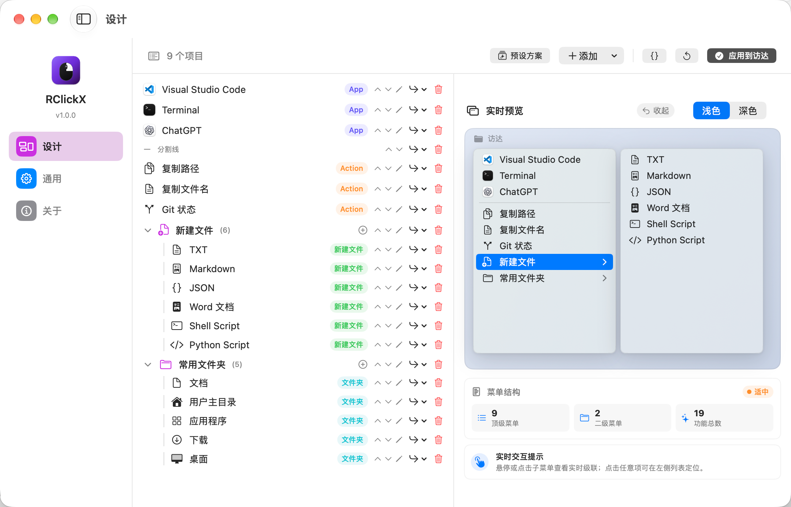
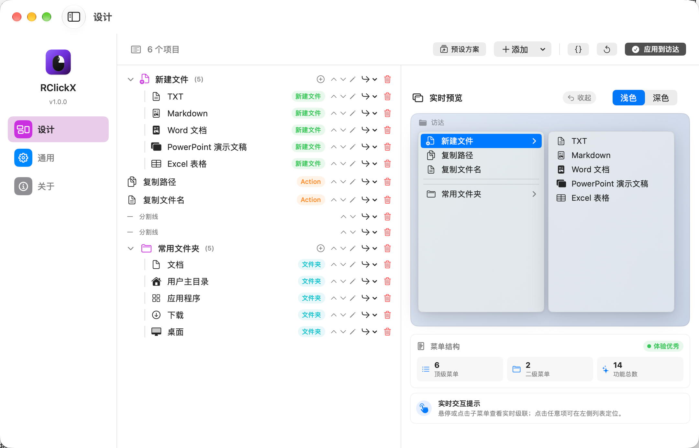
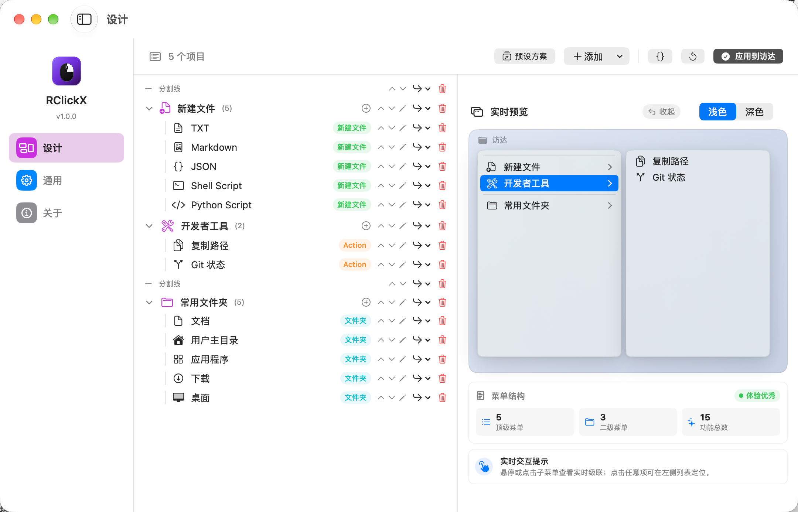
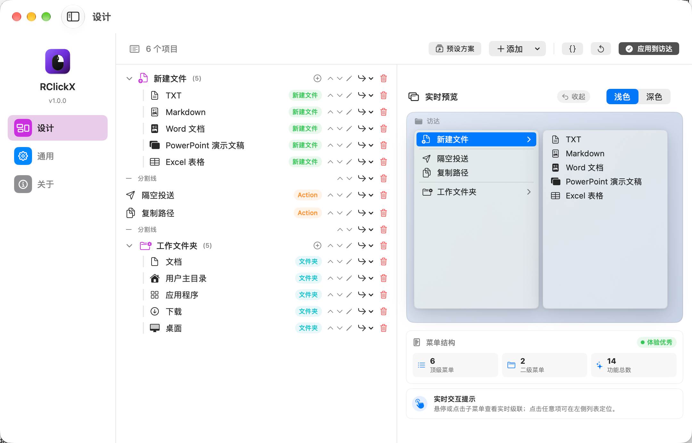
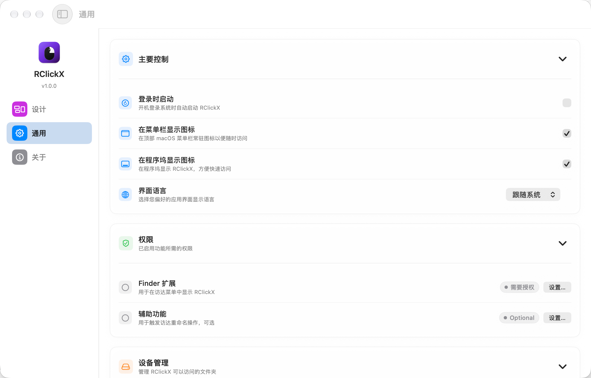

<p align="center">
  <a href="https://github.com/Cute-chen/RClickX/releases">
    
  </a>
</p>

<h1 align="center">RClickX</h1>

<p align="center">A macOS Finder context-menu enhancer</p>

<p align="center">
  <a href="README.md">简体中文</a> · <a href="README.en.md">English</a>
</p>

<p align="center">
  <a href="https://swift.org/"></a>
  <a href="https://developer.apple.com/xcode/swiftui/"></a>
  <a href="https://www.apple.com/macos/"></a>
  <a href="https://developer.apple.com/xcode/"></a>
  <a href="LICENSE"></a>
</p>

RClickX brings common file actions, application launchers, new-file templates, and favorite folders into Finder, with a visual menu designer and explicit permission management.

> **Derivative-work notice**<br>
> This project is a derivative work of [RClick](https://github.com/wflixu/RClick) by [@wflixu](https://github.com/wflixu). The original open-source attribution is retained, and the modified source is distributed under GPLv3. RClickX is an independent project.

## 📸 Preview

### Visual menu designer

The core RClickX workspace: arrange apps, actions, file templates, and favorite folders, preview the Finder menu in real time, then click **Apply to Finder**.

<p align="center">
  <a href="./img/设计页.png">
    
  </a>
</p>

<p align="center"><sub>Click any image to view the original</sub></p>

<details>
<summary>View the three workflow presets</summary>

<table>
  <tr>
    <td width="50%" align="center">
      <a href="./img/通用预设.png"></a><br>
      <sub><b>General</b> · everyday file operations</sub>
    </td>
    <td width="50%" align="center">
      <a href="./img/开发者预设.png"></a><br>
      <sub><b>Developer</b> · terminal, code templates, and tools</sub>
    </td>
  </tr>
  <tr>
    <td colspan="2" align="center">
      <a href="./img/办公预设.png"></a><br>
      <sub><b>Office</b> · Office documents and file sharing</sub>
    </td>
  </tr>
</table>

</details>

<details>
<summary>View onboarding, General settings, and About</summary>

<table>
  <tr>
    <td width="50%" align="center">
      <a href="./img/新手引导页.png"></a><br>
      <sub><b>Onboarding</b> · extension, folders, presets, and language</sub>
    </td>
    <td width="50%" align="center">
      <a href="./img/通用设置页.png"></a><br>
      <sub><b>General settings</b> · startup, icons, language, and permissions</sub>
    </td>
  </tr>
  <tr>
    <td colspan="2" align="center">
      <a href="./img/关于页.png"></a><br>
      <sub><b>About</b> · version, update check, and community links</sub>
    </td>
  </tr>
</table>

</details>

## ✨ Features

- **Ready to use**: the first-launch flow guides you through enabling the Finder extension and authorizing commonly used folders.
- **Three workflow presets**: choose General, Developer, or Office during onboarding or in the designer, then customize the layout.
- **Visual menu designer**: reorder items with drag and drop, create nested submenus and separators, customize titles and SF Symbols, and preview the menu structure in real time.
- **Application launchers**: detect installed Ghostty, Warp, iTerm2, Terminal, Cursor, VS Code, Zed, and Sublime Text.
- **File actions**: copy file names, copy absolute paths, create symbolic links, and calculate SHA-256; MD5 is available as a separate action.
- **New files**: create `.txt`, `.json`, `.md`, `.docx`, `.pptx`, `.xlsx`, `.pages`, `.key`, and `.numbers` files from templates, or drop an existing file into Settings to add a template.
- **System helpers**: permanent delete (bypass Trash), AirDrop, hide/unhide, and quick access to common folders.
- **Per-folder authorization**: file operations use macOS security-scoped bookmarks and do not require Full Disk Access.
- **Built-in update check**: the About page checks GitHub Releases and reports available updates.
- **Dark mode**: the app and Finder menu icons follow the macOS appearance.

## 🏗 Architecture

| Component | Directory | Responsibility |
| --- | --- | --- |
| Main app | `RClick/` | SwiftUI settings, state, permissions, persistence, and file operations |
| Finder extension | `FinderSyncExt/` | Reads the current Finder target and renders the context menu |
| Shared code | `Shared/` | Menu models, actions, localization, and inter-process message models |

The two processes communicate through `DistributedNotificationCenter`. Configuration and SwiftData records are shared through an App Group. If the extension or main app is unavailable, Finder shows a status message instead of silently failing.

## 📦 Installation

1. Download the latest `RClickX-vX.Y.Z.dmg` from [Releases](https://github.com/Cute-chen/RClickX/releases).
2. Open the DMG and drag **RClickX.app** to `Applications`.
3. Launch RClickX and follow onboarding to enable the Finder extension.
4. Add the folders where file actions should be allowed.

The exact System Settings labels vary by macOS release. On macOS 26/27, the extension is usually under **System Settings → General → Login Items & Extensions → Extensions → Finder**; older releases use **Privacy & Security → Extensions → Finder Extensions**. After a folder is authorized once, RClickX stores a security-scoped bookmark for later operations.

### Homebrew Cask

The repository includes a Cask definition at `Casks/rclickx.rb`. Publish it to your own tap before installing it through Homebrew; until then, the GitHub Release DMG is the recommended installation path.

## 🔧 Build from source

### Requirements

- macOS 14.0 or later
- Xcode 16.4 or later
- The packaging script defaults to Apple Silicon `arm64`
- A valid Developer ID or development signing setup is required for a normally installed Finder extension; unsigned builds are useful for compile and unit-test checks

```bash
git clone https://github.com/Cute-chen/RClickX.git
cd RClickX
open RClick.xcodeproj
```

Build and test without a signing identity:

```bash
xcodebuild build \
  -project RClick.xcodeproj \
  -scheme RClick \
  -destination 'platform=macOS' \
  CODE_SIGN_IDENTITY='' \
  CODE_SIGNING_REQUIRED=NO \
  CODE_SIGNING_ALLOWED=NO

xcodebuild test \
  -project RClick.xcodeproj \
  -scheme RClick \
  -destination 'platform=macOS' \
  CODE_SIGN_IDENTITY='' \
  CODE_SIGNING_REQUIRED=NO \
  CODE_SIGNING_ALLOWED=NO
```

Create a DMG, ZIP, and SHA-256 checksum locally:

```bash
./scripts/build-dmg.sh --config Release
```

Artifacts are written to `dist/` by default. Without a signing identity, the script uses an ad-hoc signature, which is not a replacement for Developer ID signing and notarization.

## 🧩 Custom menus

Add, reorder, and group items in **Settings → Designer**, then click **Apply to Finder**. The designer also lets you view the generated `custom_menu.json`, which stores top-level items, nested submenus, separators, and custom titles. See [examples/README.md](examples/README.md) for the schema and examples.

## 🌐 Languages

The README and app support Simplified Chinese and English. Choose **Follow System**, **简体中文**, or **English** during onboarding or in **Settings → General → Language**. Follow System uses Simplified Chinese for Chinese system languages and English otherwise.

## 👥 Credits

- Original author: 李旭 ([@wflixu](https://github.com/wflixu)) — [RClick](https://github.com/wflixu/RClick)
- Menu tree and mounted-volume work: [@Juns-g](https://github.com/Juns-g)
- French, Spanish, and string-catalog contributions: [@Dam0rt](https://github.com/Dam0rt), [@EliasMatDev](https://github.com/EliasMatDev), [@P013onEr](https://github.com/P013onEr)
- Finder observation fix: [@shoal-rat](https://github.com/shoal-rat)
- Other code and build improvements: [@chunyang-wen](https://github.com/chunyang-wen), [@stors789](https://github.com/stors789)

## 🤝 Contributing

Please open an issue or pull request after reading [CONTRIBUTING.md](CONTRIBUTING.md), [SECURITY.md](SECURITY.md), [CODE_OF_CONDUCT.md](CODE_OF_CONDUCT.md), and [CHANGELOG.md](CHANGELOG.md).

## 📜 License

RClickX is released under the [GNU General Public License v3.0](LICENSE). When redistributing a modified version, retain the GPLv3 text and the original copyright and attribution notices, and clearly identify your modifications.
